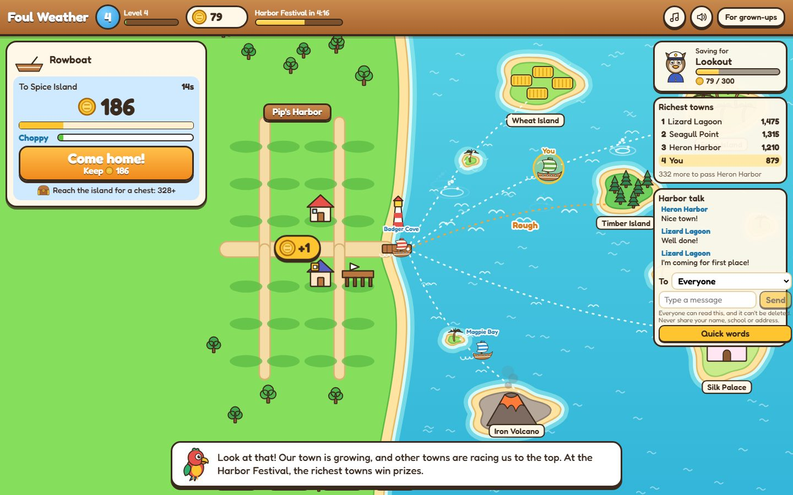
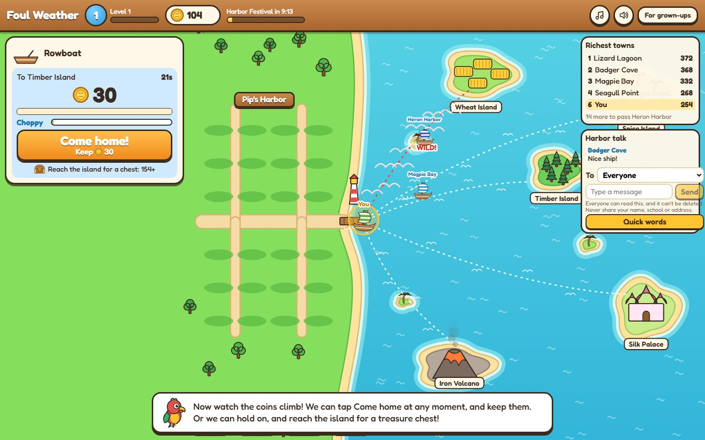
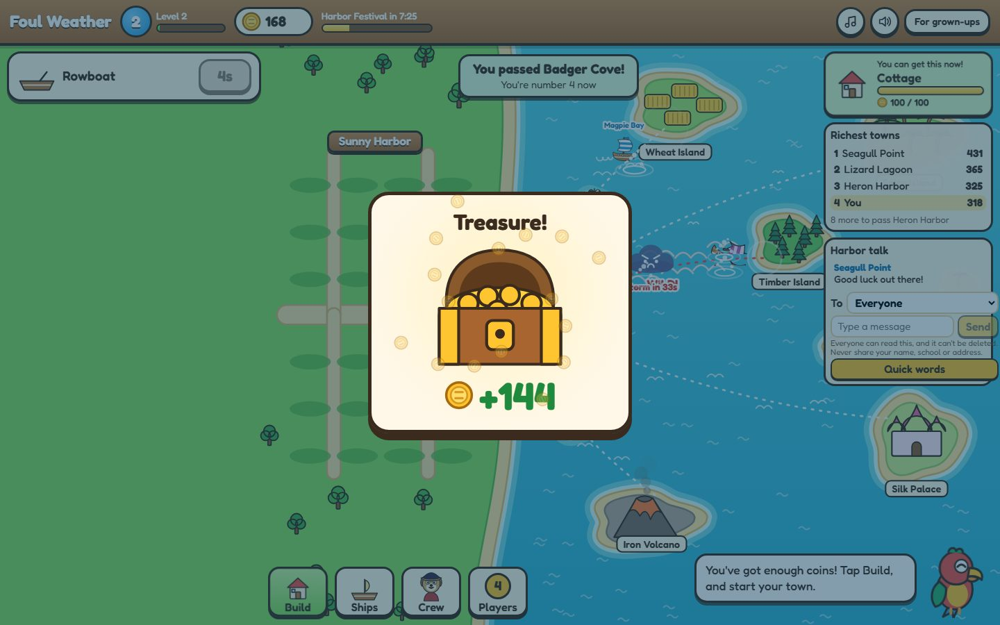
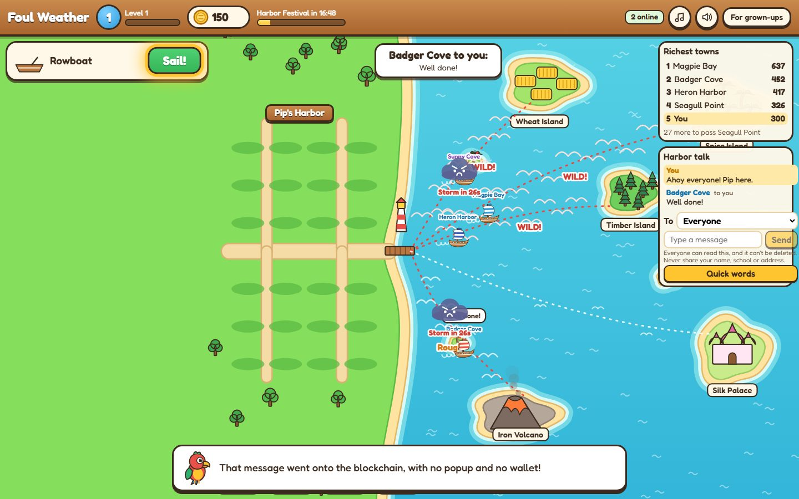
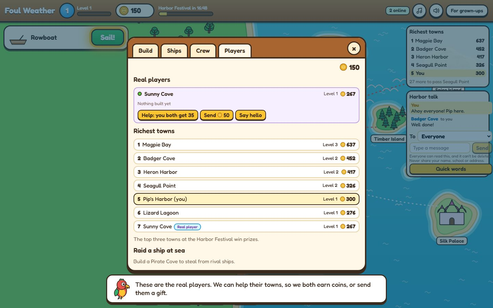
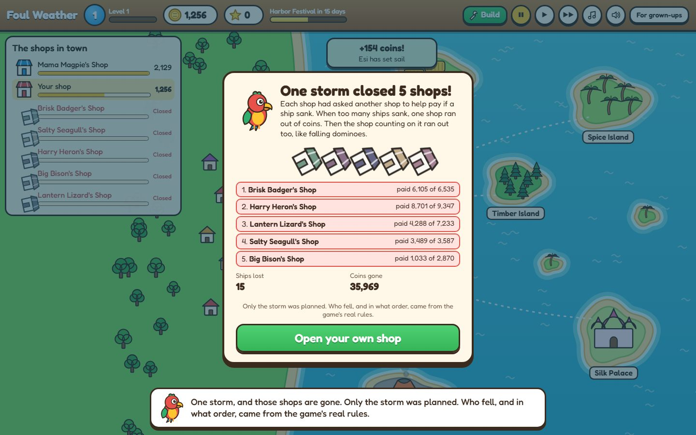

# Foul Weather

**Send your ships out. Come home in time, or risk it for treasure. Build a town, and play with your friends.**

A bright harbor game that a child can play, on top of an economy an auditor can check. Every trip is a gamble: the cargo gets more valuable the further it sails, and so does the danger. Spend what you win on ships, buildings and crew, and race other towns to the Harbor Festival. Online, real people share one sea. They chat, help each other's towns, send gifts, sail together, insure each other's trips and send pirates after each other's ships.

Built at NEAR HACKATHON (1 to 14 November 2026). Track: **Games With Real Economies** (`games`). Also fits **Agent Economy** (`agents`).



| | |
| --- | --- |
| Play it now, nothing to install | <https://enohggp.github.io/foul-weather/> |
| Contract (NEAR testnet) | [`foulweather-harbor.testnet`](https://testnet.nearblocks.io/address/foulweather-harbor.testnet) |
| Demo film, about two minutes | [`docs/demo/foul-weather-film.mp4`](docs/demo/foul-weather-film.mp4) |
| Rulebook, every price and decision in one file | [`crates/core/src/rules.rs`](crates/core/src/rules.rs) |
| The loop on paper | [`docs/GAME_LOOP.md`](docs/GAME_LOOP.md) |
| How NEAR is used | [`docs/NEAR.md`](docs/NEAR.md) |
| AI assistance and libraries | [`docs/AI_AND_LIBRARIES.md`](docs/AI_AND_LIBRARIES.md) |

**Testnet only, and the game uses no NEAR tokens.** Coins (called crowns in the contract) are game points. They can't be bought, sold or withdrawn, and there is no wagering. The one part on mainnet is sharing to near.social, because near.social only runs there.

## The problem

Most game economies are a price table with a shop on top. Players trade against it, but nothing they do has consequences beyond the next price, and the same few moves always win.

Foul Weather is built around one tense choice, repeated: keep what you have, or risk it for more. Around that choice is a real market. What you deliver moves prices, the shops that insure ships can go broke, and other people can help you or rob you.

## Try it in two minutes

The quickest way is the hosted game at <https://enohggp.github.io/foul-weather/>. To run it yourself, you need Node 24 or newer. Rust is not needed to play.

```bash
git clone https://github.com/enohggp/foul-weather.git
cd foul-weather
npm install
npm run dev
```

Open <http://localhost:3000>. Use that exact address, because Google and email sign-in only works there.

The quickest way to see everything is **Watch Pip play** on the title screen. Pip the parrot plays the real game for about four minutes, explaining each step aloud, and finishes on NEAR testnet. Press Esc to stop it.

Or try it yourself. Each step says what to do and what you should see.

1. **Do:** name your town and press **Play!**. **See:** your town, a boat and a big **Sail!** button. There's no lesson first.
2. **Do:** tap **Sail!** and pick an island. **See:** the coin counter climbing and a danger bar.
3. **Do:** tap **Come home!** at any moment, or hold on. **See:** coins banked, a treasure chest to open, or a shipwreck.
4. **Do:** spend your coins with **Build**, **Ships** and **Crew**. **See:** buildings appear on your land, and the card at the top right shows what to save for next.
5. **Do:** tap the gold coins on your town. **See:** the income your buildings have earned while you sailed.
6. **Do:** go back to the title and press **Play with others**. **See:** the same game, shared and on NEAR testnet. You join as a guest, with no popup or gas prompt. Open it in a second browser to play against yourself.
7. **Do:** on the title, choose **Connect your NEAR wallet (testnet)** and pick a wallet, such as Meteor, Intear, Nightly, Ledger or NEAR CLI. **See:** the wallet asks once to add a key that can only call the game. After that you play with no prompts, your account name shows at the top of your town, and everything your town earns is paid to your own account.
8. **Do:** tap **Players**, or type in **Harbor talk**. **See:** the people who are online, with buttons to help them or send a gift.
9. **Do:** tap **Share** at the top of your town. **See:** a box to connect a NEAR mainnet account and post your town on near.social.
10. **Do:** tap **For grown-ups**, then **Watch a spiral collapse**, or open <http://localhost:3000/?demo=spiral>. **See:** a great storm, then the harbor's insurance shops toppling one after another.
11. **Do:** press **More ways to play** on the title screen. **See:** the insurance market from the inside: run a shop that protects ships, or take the wheel of a captain's ship.

Sound starts with your first tap, because browsers keep a page silent until then. After that it plays on every screen: waves, gulls, a little tune that turns darker in a big storm, and Pip's voice. The speaker button mutes everything, and the note button stops only the music.

## Ways to make money

| Way | How |
| --- | --- |
| Trips | Bank the cargo on the way, or reach the island for the full value and a treasure chest worth up to five times as much. |
| Your town | Cottages, stalls, bakeries, inns and a market hall earn coins while you do something else. |
| A run of luck | Every chest in a row adds to your pay, up to +50%. Sinking resets it. |
| Surprises | Grab a floating crate, fight pirates for treasure, or take a dangerous shortcut. |
| Raids | Build a Pirate Cove and steal from ships at sea. |
| Insurance | Build an office, and other players pay you to protect their trips. |
| Festival prizes | The three richest towns at the end of each season win coins. |
| Helping | Help another player's town and you both get paid. |

## Playing with other people

Everyone who presses **Play with others** joins one shared sea on the contract, so there are no rooms to set up. Real players are marked in purple, and towns run by the computer are tagged **bot** everywhere they appear. The top bar shows how many real people did something in the last three minutes.

| What you can do | What happens |
| --- | --- |
| **Talk** | Type a message, or tap a quick phrase, to everyone or to one person. It appears in Harbor talk and over your ship on the map. |
| **Help a town** | You both earn coins and experience. |
| **Send a gift** | Real coins move from your account to theirs. |
| **Sail together** | While another real player sails your route, you're both 35% safer. |
| **Protect each other** | If someone owns an Insurance Office, your trip goes to them first when their price is close. They earn the fee, and pay you if you sink. |
| **Raid** | Send pirates after a ship. Its owner gets a warning and has a moment to run for home. |
| **Race** | Everyone is on one table, heading for the same Festival. |

Chat is public and can't be deleted from the chain, and children play this game. So links, email addresses, phone numbers and the commonest bad words are turned away, every player can mute anyone, and the box says plainly not to share personal details. That is a first line of defence and not real moderation. See **Known limits**.

Rival towns run by the game keep the sea busy when nobody else is around, and they answer when you talk, so a **bot** tag is the only way to tell them from people in the chat.

## Your own wallet, and near.social

| Option | What happens |
| --- | --- |
| **Connect your NEAR wallet (testnet)** | [NEAR Connect](https://github.com/hot-dao/near-selector) opens your wallet. It asks once to add a key that can only call the game's contract, with a gas allowance of 1 testnet NEAR. Your town then belongs to your own account: every coin and ship it earns is a token your account holds in the contract, and gifts, prizes and insurance payouts are paid to it. Moves use a little of your own testnet NEAR for gas, about 0.0004 each, so the allowance lasts a couple of thousand moves. |
| **Share on near.social** | Tap **Share** in your town, or after a level-up or a Harbor Festival. Connect a NEAR mainnet account and post the moment on [near.social](https://near.social), the social network on NEAR. Your wallet signs each post. Posts are public, and each costs a network fee well under a cent. |

The game itself uses no NEAR tokens. You can always play as a guest instead, with nothing to set up.

## Two layers

The cartoon is a friendly face on the real game. Nothing about it is faked.

- **What a child sees:** a coin counter, the waves, and two choices: come home or carry on.
- **What Pip says out loud:** one short tip when it's useful, so a child who can't read yet can still play.
- **What is really happening:** every ship, coin and policy is a token in one NEAR contract. Deliveries change port prices. Protection is bought from the same shops that insure the animal captains.
- **What a grown-up can open:** **For grown-ups** shows the whole market: positions, reinsurance offers, who relies on whom, goods prices, and the live contract.

## Check the chain yourself

```bash
npm run verify
```

This reads the live contract and prints the season, a live audit ("the books balance"), the fixed crown supply, token types and sea reports. It needs no key.

Or look at it directly:

```bash
curl -s https://rpc.testnet.fastnear.com -H 'content-type: application/json' -d '{"jsonrpc":"2.0","id":1,"method":"query","params":{"request_type":"call_function","finality":"optimistic","account_id":"foulweather-harbor.testnet","method_name":"audit","args_base64":"e30="}}'
```

The result bytes decode to `"the books balance"`.

## Test it

```bash
cargo test -p nep245-ledger -p foul-core -p foul-engine-wasm
node scripts/e2e-contract.mjs
```

The first command runs 111 tests. They include a full-season audit on every watch, so every balance adds up to supply and no coin is ever created or destroyed, regression tests for attacks found in code review ([`crates/core/tests/exploits.rs`](crates/core/tests/exploits.rs)), and tests of what players can do to each other ([`crates/core/tests/together.rs`](crates/core/tests/together.rs)). The second runs real transactions against the deployed contract, and each run opens one new test account.

To see how the game behaves over many seasons:

```bash
cargo run --release -p foul-core --example town_styles -- 150
cargo run --release -p foul-core --example balance -- 300
```

Results are in [`docs/GAME_LOOP.md`](docs/GAME_LOOP.md).

## Bring your own agent

```bash
node scripts/agent-house.mjs
```

That is a complete insurance shop in about 100 lines. It opens its own account, founds a shop marked as an agent, and signs through the contract's public methods. Set `NEAR_AI_API_KEY` and it asks a model on NEAR AI Cloud instead of using rules. Rewrite its `byRule` function and your agent is competing in the same harbor as everyone else.

## What it looks like

| | |
| --- | --- |
|  |  |
|  |  |
|  |  |
|  |  |

## How it fits the track

| The track asks for | Foul Weather |
| --- | --- |
| NPCs with wallets | Rival towns, 12 animal captains and 6 shops. Captains and shops have NEAR sub-accounts with no key at all, so only the rules can move their money. |
| Player-owned markets | Players own ships (each a NEP-245 token), buildings and insurance offices. Players sell each other protection, and shops trade risk through reinsurance. Policies are tokens, so a claim can be sold. |
| Economies that evolve without a dev patch | What players deliver moves prices. Fees, sailings and new capital feed each other, and live NEAR Intents quotes set the sea. |
| Judged on the game loop | See [`docs/GAME_LOOP.md`](docs/GAME_LOOP.md). In 150 bot-played seasons per style, nothing simple always wins: never risking finishes near the bottom, and pushing on blindly sinks 38% of trips. |
| Players never notice the chain | The game uses no NEAR tokens. A guest starts with nothing to set up and never sees a seed phrase or gas prompt. Players who want their own account can connect a testnet wallet once, then play with no prompts while everything they earn is paid to that account. |

The track's starter prompt asks for these too:

| Starter prompt | Where |
| --- | --- |
| NEP-245, one contract for every item | `crown`, `cargo:*`, `policy:*` and `ship:*` in [`crates/contract`](crates/contract/src/lib.rs) |
| Social or email login | NEAR Auth, an instant guest account, or your own wallet through NEAR Connect. Players can also share to near.social. |
| Pricing rules in one readable file, with reasoning in a tooltip | [`rules.rs`](crates/core/src/rules.rs), and hover any price in the Harbor tab under **For grown-ups** |
| A broke merchant closes until someone invests | A broke captain is laid up until a shop helps them, and repays from later voyages |
| A week of trading in a minute | **Run a week in a minute** |

## How it's built

```
crates/core            The rules, once. Deterministic, integer-only, no chain code.
crates/contract        The rules on NEAR: world, tokens, front door. No game server.
crates/engine-wasm     The same rules in the browser, for practice and fast-forward.
crates/nep245-ledger   A reusable NEP-245 ledger with no SDK dependency.
web/                   React client, with all art drawn in code. All NEAR calls are in web/src/live.ts.
scripts/               Deploy helpers, keeper, verification, agent house, Pip's recordings.
```

`tick` is public, so players' browsers move the world on. A watch costs about 8 Tgas and a player's move about 3 Tgas, because the whole world fits in about 13 KB of state.

To rebuild from source you need Rust and [`cargo-near`](https://github.com/near/cargo-near):

```bash
cargo build --release -p foul-engine-wasm --target wasm32-unknown-unknown
cp target/wasm32-unknown-unknown/release/foul_engine_wasm.wasm web/public/engine.wasm
(cd crates/contract && cargo near build non-reproducible-wasm --no-abi)
```

`cargo test` on the whole workspace won't work, because `near-sdk` refuses a plain host build of the contract. Use the `-p` flags above.

## Known limits

- **Chat moderation is basic.** The filter blocks links, contact details and common English swear words, and it can be got around. Muting is per device. Messages stay in public transaction history for good. A release for children would need real moderation, or the preset phrases only.
- **The live world only moves while someone is playing.** Each tick costs the contract NEAR, so a browser tab only sends them while it is visible and has been touched in the last two minutes. With nobody active the world pauses, unless `scripts/keeper.mjs` runs. Live sea readings on-chain also need the keeper.
- **Free moves are limited.** A guest account opened through the contract's front door holds 0.06 testnet NEAR, about 150 moves. Accounts from NEAR's public faucet hold more.
- **A guest town can't move to a wallet.** Connecting a NEAR wallet starts a new town for that account. The game's key on a wallet has a 1 testnet NEAR gas allowance. When it runs out, connect the wallet again.
- **near.social is on NEAR mainnet.** Sharing needs a mainnet NEAR account, and each post costs that account a network fee well under a cent. Everything else in the game is testnet only.
- **The front door needs testnet NEAR.** It stops opening accounts when the contract's spare balance runs low. Guests then rely on the public faucet, which limits each address, and Google and email sign-in has to wait for a top-up.
- **Up to 40 player towns in one harbor.** After that, new players are told it's full.
- **Google and email sign-in** only works at `http://localhost:3000` until a site has its own NEAR Auth client id. A login opened on one device can't yet be restored on another. Guest play has no such limit.
- **Practice towns live in the browser.** They are saved on one device and are separate from your online town.
- **Practice and fast-forward run in the browser**, using the contract's rules but no transactions. A season on-chain plays in real time.
- **The two players in the demo film** are real testnet accounts, filmed live on the contract, but a script drives them. The film says so on screen.
- **The rest of the demo film is practice mode, sped up in places.** Its great storm was started with the practice button. Who fell, and in what order, came from the game's rules. The voices are AI-generated. See [`docs/AI_AND_LIBRARIES.md`](docs/AI_AND_LIBRARIES.md).
- **Surveys are private in the page, not on-chain.** See [`docs/NEAR.md`](docs/NEAR.md). In the same way, whether a player-steered wreck was deliberate is stored in contract state, so a determined reader could look it up.
- **Pay from any chain is a preview.** Quotes are live, but nothing can be bought.
- **The owner can reset the world** while this is a hackathon build.
- **Two towns run by one person** can pass small gifts and help each other. There are limits on size and how often, and coins are game points, so this only affects the leaderboard.
- **The busiest watches can leave their last events out of the logs**, because NEAR limits log size. The state is always complete.

## Libraries and AI

Everything here was written during the hackathon with Claude Code, directed by the team. There is no earlier code.

| Part | Libraries |
| --- | --- |
| Contract | `near-sdk`, `borsh`, `serde`, built with `cargo-near` |
| Browser and scripts | `near-kit` for transactions, `@hot-labs/near-connect` for players' own wallets, `@fast-auth-near/*` and `near-api-js` for NEAR Auth |
| Web client | React, Vite, TypeScript, the Fredoka font |
| Voices | Pip: Kokoro-82M. Demo film: Orpheus 3B. Both are AI-generated. |

The full list, with licences and the services the game calls, is in [`docs/AI_AND_LIBRARIES.md`](docs/AI_AND_LIBRARIES.md).

## License

MIT. See [`LICENSE`](LICENSE).
