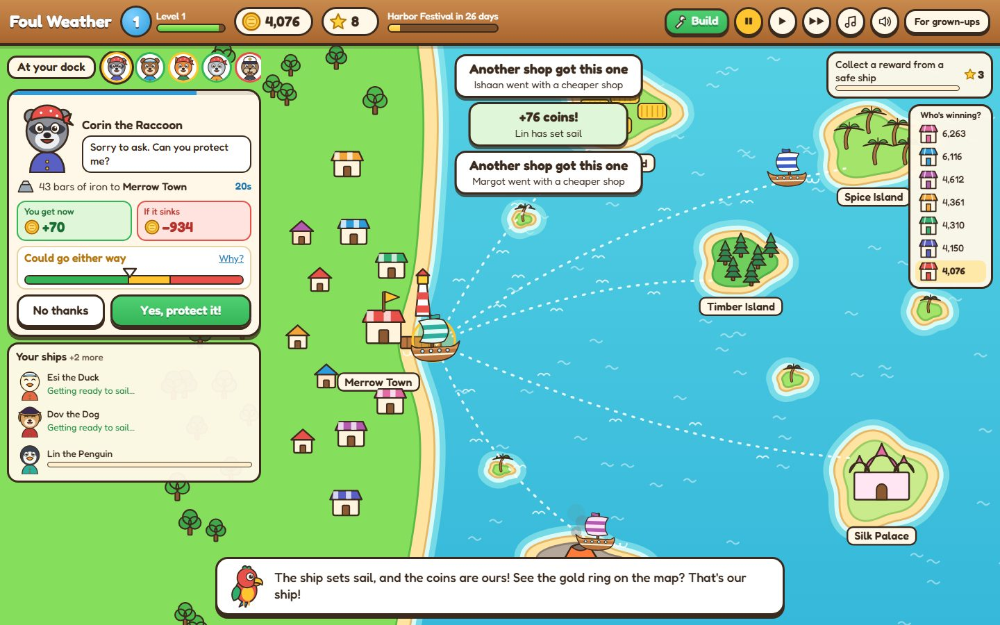
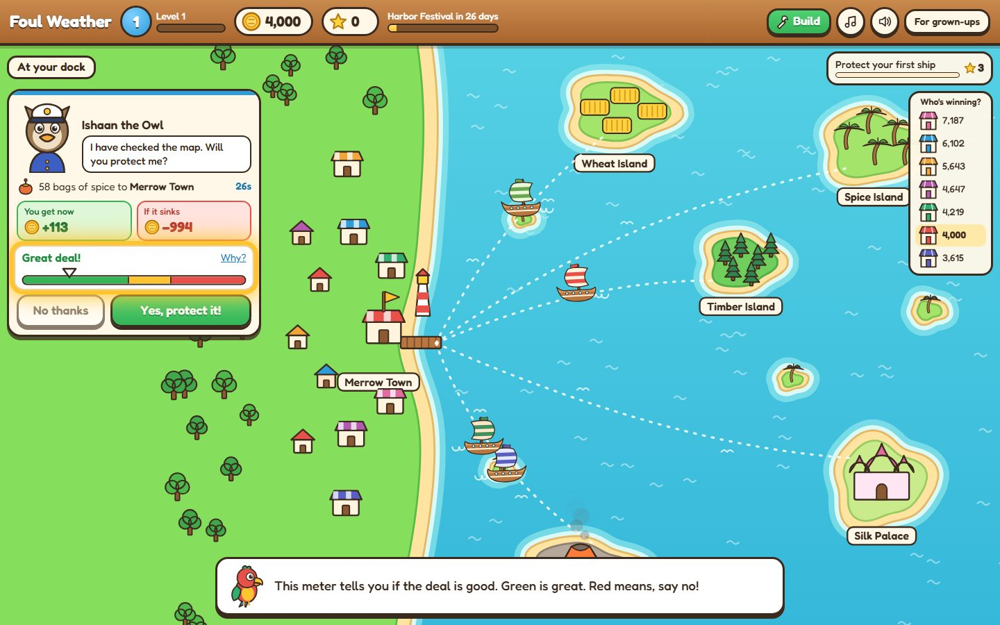
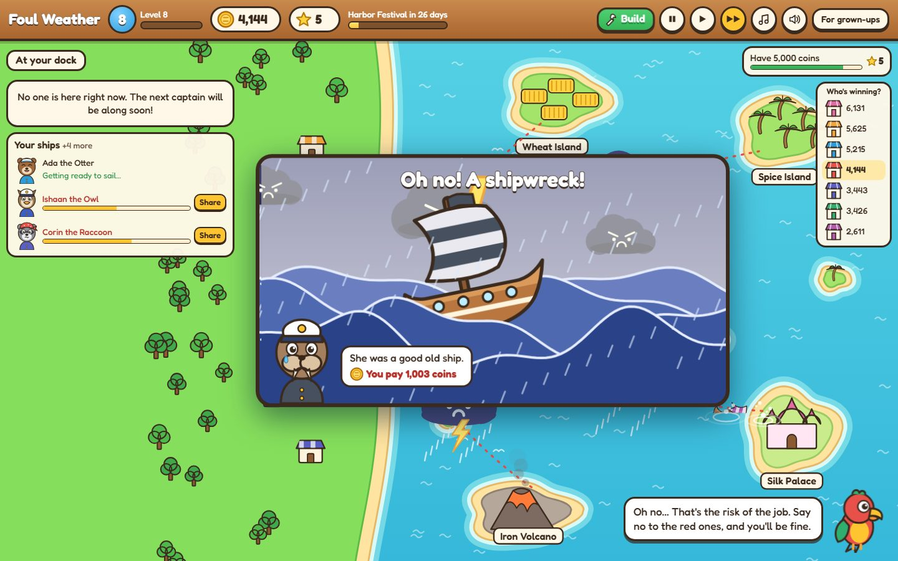
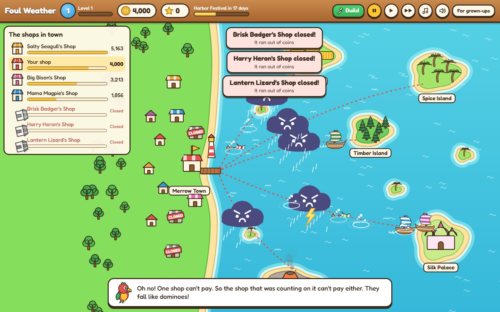
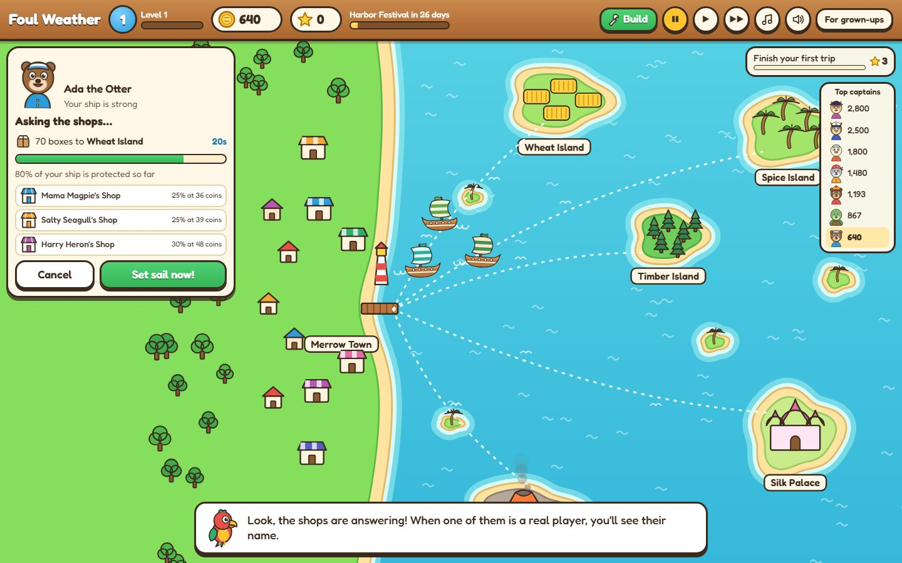
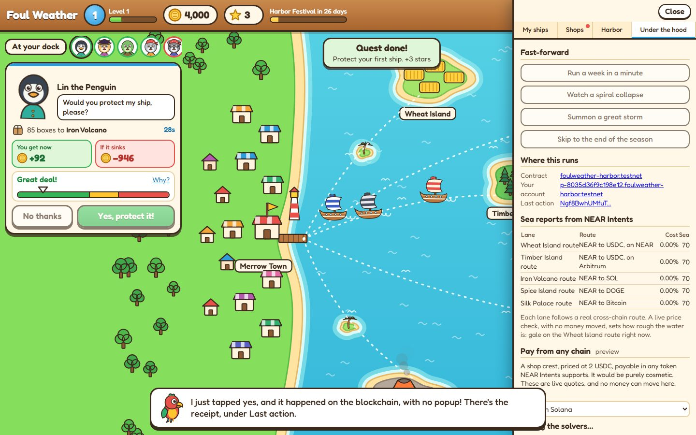

# Foul Weather

**You don't trade the goods. You carry the risk.**

A bright harbor game that a child can play, on top of an economy an auditor can check. Run a shop that protects ships, or take the wheel of a ship yourself. Shops and captains deal with each other, and online either side can be a real person. Underneath is a real insurance market: one storm can bring down a chain of shops that all thought they had passed their risk on to someone else.

Built at NEAR HACKATHON (1 to 14 November 2026). Track: **Games With Real Economies** (`games`). Also fits **Agent Economy** (`agents`).



| | |
| --- | --- |
| Contract (NEAR testnet) | [`foulweather-harbor.testnet`](https://testnet.nearblocks.io/address/foulweather-harbor.testnet) |
| Demo video, Pip plays the real game, with voice and sound | [`docs/demo/foul-weather-demo.mp4`](docs/demo/foul-weather-demo.mp4) |
| Rulebook, every price and decision in one file | [`crates/core/src/rules.rs`](crates/core/src/rules.rs) |
| The loop on paper | [`docs/GAME_LOOP.md`](docs/GAME_LOOP.md) |
| How NEAR is used | [`docs/NEAR.md`](docs/NEAR.md) |
| AI assistance and libraries | [`docs/AI_AND_LIBRARIES.md`](docs/AI_AND_LIBRARIES.md) |

**Testnet only.** Coins (called crowns in the contract) are game points. They can't be bought, sold or withdrawn, and there is no wagering.

## The problem

Most game economies are a price table with a shop on top. The market town has become the standard answer: merchants, supply and demand, a shop that can go broke. Players trade against it, but nothing they do has consequences beyond the next price.

Risk is a more interesting thing to trade than goods, and it's what real markets break on. In Foul Weather, your prices decide which captains can afford to sail. That decides which goods reach port, which decides what captains can pay you. You can't opt out of the economy, because you are its insurer.

## Try it in two minutes

You need Node 24 or newer. Rust is not needed to play.

```bash
git clone <this repository>
cd foul-weather
npm install
npm run dev
```

Open <http://localhost:3000>. Use that exact address, because Google and email sign-in only works there.

The quickest way to see everything is **Watch Pip play** on the title screen. Pip the parrot plays the real game for about four minutes, as a shop and then as a captain, explaining each step aloud, and finishes with a real move on NEAR testnet. The world holds still while Pip explains. Press Esc to stop it.

Or try it yourself. Each step below says what to do and what you should see.

1. **Do:** type a name, press **Play!**, then **Run a shop**. **See:** a bright harbor, a captain at your dock, and Pip. The world waits for you.
2. **Do:** follow Pip's five short steps, then tap **Yes, protect it!**. **See:** the world starts. Coins fly to your counter when the ship sails, and it gets a gold ring on the map.
3. **Do:** wait about 30 seconds. **See:** a cartoon of the ship coming home and a star to tap, or a shipwreck and a bill.
4. **Do:** tap **Why?** on a captain's card, and **No thanks** on a deal in the red. **See:** the reasoning in plain words, and Pip's approval.
5. **Do:** finish quests and tap **Build**. **See:** your stars become decorations on the map. Each level adds one new skill: sharing the danger, the ship inspector, the detective, and helping a broke captain.
6. **Do:** tap **For grown-ups**, then **Run a week in a minute**. **See:** Pip runs your shop for a week, followed by charts of the average fee, town prices and the coins in all the shops.
7. **Do:** in the same panel, press **Watch a spiral collapse**, or open <http://localhost:3000/?demo=spiral>. **See:** a great storm, then shops toppling one after another. It ends with a list of who fell and in what order.
8. **Do:** go back to the title, press **Play!**, then **Be a captain** and choose an animal. **See:** your own ship. Pick an island, choose how much to pay for protection, and watch the shops answer before you sail.
9. **Do:** go back to the title, and press **Play with others**. **See:** the same game, shared and on NEAR testnet, with no wallet, popup or gas prompt. Real players are marked by name: a shop sees "Real player" on a captain's card, a captain sees which shops are real, and real players' ships carry their names on the map. **For grown-ups** links your account and your last transaction on an explorer.

Sound starts with your first tap, because browsers keep a page silent until then. After that it plays on every screen: waves, gulls, a little tune that turns darker in a big storm, and Pip's voice. The speaker button mutes everything, and the note button stops only the music. No Rust is needed for any of this, because the compiled rules are in `web/public/engine.wasm`.

## Two sides of every deal

| | A shop | A captain |
| --- | --- | --- |
| Earns by | Fees for protecting ships | Buying cargo cheap and selling it dear |
| Decides | Yes or no to each captain | Where to sail, and how much to offer for protection |
| Fears | Paying for a shipwreck | Sinking with no protection |
| Can be tempted to | Take every deal | Sink a protected ship on purpose, if nobody would check |

Any of the 12 captains can be steered by a person, and the rest are run by the rules, so the town is busy even with one player. A person can't run a shop and steer a ship at the same time, so nobody can protect their own ship. If a captain played by a person sinks, whether it was deliberate is recorded, so an honest player is never wrongly found guilty, and shops can pay to look into it.

## Two layers

The cartoon is a friendly face on the real game. Nothing about it is faked.

- **What a child sees:** one captain at a time, what you get now, what you pay if it sinks, and a meter from green to red. Yes or no.
- **What is really happening:** each yes is a real quote on the slip. The client works out the fee and takes a share of the ship small enough that one wreck costs about a quarter of your coins, so a beginner can't lose everything to bad luck, and deals grow as the shop grows. The meter is the expected loss divided by the pay.
- **What Pip says out loud:** every lesson and tip, so a child who can't read yet can still play.
- **What stays on the device:** levels, quests, stars and decorations. They teach the game one idea at a time and never touch the economy.
- **What a grown-up can open:** **For grown-ups** shows the whole market: positions, reinsurance offers, the network of who relies on whom, goods prices, and the live contract.

## Check the chain without a wallet

```bash
npm run verify
```

This reads the live contract and prints the season, a live audit ("the books balance"), the fixed crown supply, token types and sea reports. It needs no key.

Or look at it directly:

```bash
curl -s https://rpc.testnet.fastnear.com -H 'content-type: application/json' -d '{"jsonrpc":"2.0","id":1,"method":"query","params":{"request_type":"call_function","finality":"optimistic","account_id":"foulweather-harbor.testnet","method_name":"audit","args_base64":"e30="}}'
```

The result bytes decode to `"the books balance"`.

## Test it

```bash
cargo test -p nep245-ledger -p foul-core -p foul-engine-wasm
node scripts/e2e-contract.mjs
```

The first command runs 79 tests. They include a full-season audit on every watch, so every balance adds up to supply and no coin is ever created or destroyed, plus regression tests for the attacks found in code review ([`crates/core/tests/exploits.rs`](crates/core/tests/exploits.rs)). The second runs real transactions against the deployed contract.

To see how the economy behaves over many seasons:

```bash
cargo run --release -p foul-core --example balance -- 300
cargo run --release -p foul-core --example spiral -- 300
```

Results are in [`docs/GAME_LOOP.md`](docs/GAME_LOOP.md).

## Bring your own agent

```bash
node scripts/agent-house.mjs
```

That is a complete shop in about 100 lines. It opens its own account, founds a shop marked as an agent, and signs through the contract's public methods. Set `NEAR_AI_API_KEY` and it asks a model on NEAR AI Cloud instead of using rules. Rewrite its `byRule` function and your agent is competing in the same town as everyone else.

## What it looks like

| | |
| --- | --- |
|  |  |
|  |  |
|  |  |

## How it fits the track

| The track asks for | Foul Weather |
| --- | --- |
| NPCs with wallets | 12 animal captains and 6 rival shops, each with a NEAR sub-account that has no key at all. Only the rules can move their money. |
| Player-owned markets | People play both sides: a captain asks, shops answer, and the cheapest cover wins. Shops also trade risk with each other through reinsurance. Policies are NEP-245 tokens, so a claim can be sold. |
| Economies that evolve without a dev patch | Premiums, sailings, goods prices and new capital feed each other, and live NEAR Intents quotes set the sea. |
| Judged on the game loop | See [`docs/GAME_LOOP.md`](docs/GAME_LOOP.md). In bot-played seasons, signing everything failed 54% to 72% of the time, and careful play more than doubled the money. On the yes-or-no screen, saying yes to everything loses money and picking the green deals grows it. |
| Players never notice the chain | No wallet, seed phrase or gas prompt in normal play. A child can play it. |

The track's starter prompt asks for these too:

| Starter prompt | Where |
| --- | --- |
| NEP-245, one contract for every item | `crown`, `cargo:*` and `policy:*` in [`crates/contract`](crates/contract/src/lib.rs) |
| Social or email login | NEAR Auth, or an instant guest account |
| Pricing rules in one readable file, with reasoning in a tooltip | [`rules.rs`](crates/core/src/rules.rs), **Why?** on each captain's card, and hover any price in the Harbor tab under **For grown-ups** |
| A broke merchant closes until someone invests | A broke captain is laid up until a shop helps them, and repays from later voyages |
| A week of trading in a minute | **Run a week in a minute** |

## How it's built

```
crates/core            The rules, once. Deterministic, integer-only, no chain code.
crates/contract        The rules on NEAR: world, tokens, front door. No game server.
crates/engine-wasm     The same rules in the browser, for practice and fast-forward.
crates/nep245-ledger   A reusable NEP-245 ledger with no SDK dependency.
web/                   React client, with all art drawn in code. All NEAR calls are in web/src/live.ts.
scripts/               Deploy helpers, keeper, verification, agent house, Pip's recordings.
```

`tick` is public, so players' browsers move the world on. A watch costs 4 to 6 Tgas, because the whole world fits in about 11 KB of state.

To rebuild from source you need Rust and [`cargo-near`](https://github.com/near/cargo-near):

```bash
cargo build --release -p foul-engine-wasm --target wasm32-unknown-unknown
cp target/wasm32-unknown-unknown/release/foul_engine_wasm.wasm web/public/engine.wasm
(cd crates/contract && cargo near build non-reproducible-wasm --no-abi)
```

`cargo test` on the whole workspace won't work, because `near-sdk` refuses a plain host build of the contract. Use the `-p` flags above.

## Known limits

- **Live town in the background.** Players' browsers tick the world. With no one online it pauses, unless `scripts/keeper.mjs` runs. Live sea readings on-chain also need the keeper.
- **Google and email sign-in** only works at `http://localhost:3000` until a site has its own NEAR Auth client id. A login opened on one device can't yet be restored on another. Guest play has no such limit.
- **Surveys are private in the page, not on-chain.** See [`docs/NEAR.md`](docs/NEAR.md). In the same way, whether a player-steered wreck was deliberate is stored in contract state, so a determined reader could look it up.
- **A player who leaves mid-trip** hands the ship back to its captain after a few trips, so one player can never hold up the town.
- **Pay from any chain is a preview.** Quotes are live, but nothing can be bought.
- **The owner can reset the world** while this is a hackathon build.
- **Two shops run by one person can pass money between them** through reinsurance at high rates, or by selling a recovery. Coins are game points, so this only affects the leaderboard.
- **The busiest watches can leave their last events out of the logs**, because NEAR limits log size. The state is always complete.
- **Practice and fast-forward run in the browser**, using the contract's rules but no transactions. A season on-chain plays in real time.
- **Levels, quests, stars and decorations live in the browser.** They stay on one device and are not on-chain.

## License

MIT
