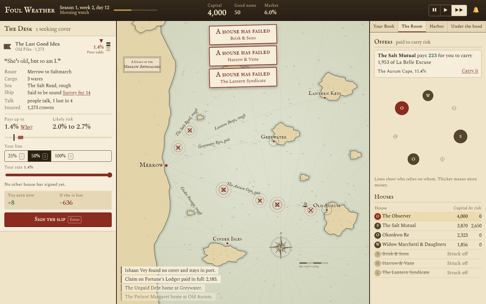
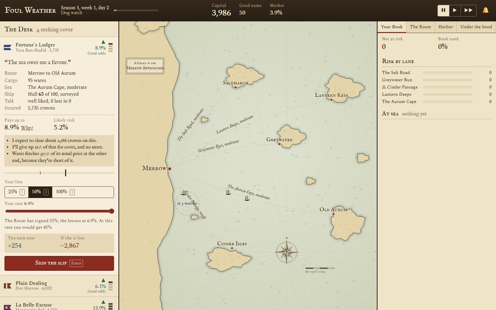
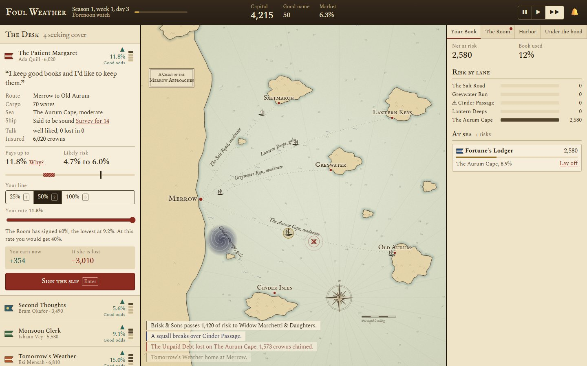
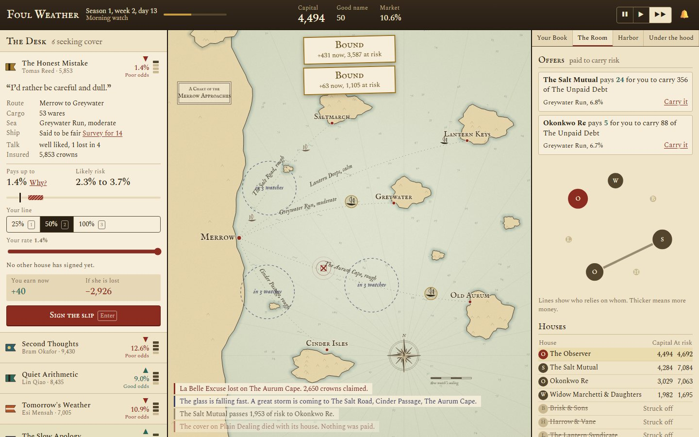

# Foul Weather

**You don't trade the goods. You carry the risk.**

A marine insurance game where the economy is the game. Captains with their own wallets need cover before they sail. You price the risk, sign the slip, and hear a bell when the ship comes home or doesn't. One storm can bring down a chain of houses that all thought they had passed their risk on to someone else.

Built at NEAR HACKATHON (1 to 14 November 2026). Track: **Games With Real Economies** (`games`). Also fits **Agent Economy** (`agents`).



| | |
| --- | --- |
| Contract (NEAR testnet) | [`foulweather-harbor.testnet`](https://testnet.nearblocks.io/address/foulweather-harbor.testnet) |
| Demo video, 2 minutes, captions, no sound | [`docs/demo/foul-weather-demo.mp4`](docs/demo/foul-weather-demo.mp4) |
| Rulebook, every price and decision in one file | [`crates/core/src/rules.rs`](crates/core/src/rules.rs) |
| The loop on paper | [`docs/GAME_LOOP.md`](docs/GAME_LOOP.md) |
| How NEAR is used | [`docs/NEAR.md`](docs/NEAR.md) |
| AI assistance and libraries | [`docs/AI_AND_LIBRARIES.md`](docs/AI_AND_LIBRARIES.md) |

**Testnet only.** Crowns are game points. They can't be bought, sold or withdrawn, and there is no wagering.

## The problem

Most game economies are a price table with a shop on top. The market town has become the standard answer: merchants, supply and demand, a shop that can go broke. Players trade against it, but nothing they do has consequences beyond the next price.

Risk is a more interesting thing to trade than goods, and it's what real markets break on. In Foul Weather, your prices decide which captains can afford to sail. That decides which goods reach port, which decides what captains can pay you. You can't opt out of the economy, because you are its insurer.

## Try it in two minutes

You need Node 22 or newer. Rust is not needed to play.

```bash
git clone <this repository>
cd foul-weather
npm install
npm run dev
```

Open <http://localhost:3000>. Use that exact address, because Google and email sign-in only works there.

Each step below says what to do and what you should see.

1. **Do:** type a house name and press **Open for business**. **See:** a sea chart and a slip from a captain. The world waits for you.
2. **Do:** press **Why?** on the slip. **See:** the captain's reasoning, from their profit and their cash.
3. **Do:** press **Survey for 14**. **See:** the likely risk narrows to one exact number, because the hull's real state was just drawn.
4. **Do:** find a slip marked "Good odds" and press **Sign the slip**. **See:** the world starts, and a "Bound" stamp appears when the captain sails. Your ship gets a brass ring on the chart.
5. **Do:** wait about 30 seconds. **See:** "Safe home" and two bells, or "Lost at sea" and one bell, and your capital changes.
6. **Do:** open **Under the hood** and press **Watch a spiral collapse**, or open <http://localhost:3000/?demo=spiral>. **See:** a great storm, then houses struck off one after another in the Room's network. It ends with a list of who fell and in what order.
7. **Do:** open **Under the hood** and press **Run a week in a minute**. **See:** a clerk runs your desk for a week, followed by charts of the market rate, Merrow's prices and the capital in the Room.
8. **Do:** go back to the title, and press **Join the live Room**. **See:** the same game, shared and on NEAR testnet, with no wallet, popup or gas prompt. **Under the hood** links your account and your last transaction on an explorer.

Sound is on by default. The bell button mutes it.

## Check the chain without a wallet

```bash
npm run verify
```

This reads the live contract and prints the season, a live audit ("the books balance"), the fixed crown supply, token types and sea reports. It needs no key.

Or look at it directly:

```bash
curl -s https://rpc.testnet.fastnear.com -H 'content-type: application/json' -d '{"jsonrpc":"2.0","id":1,"method":"query","params":{"request_type":"call_function","finality":"optimistic","account_id":"foulweather-harbor.testnet","method_name":"audit","args_base64":"e30="}}'
```

The result bytes decode to `"the books balance"`.

## Test it

```bash
cargo test -p nep245-ledger -p foul-core -p foul-engine-wasm
node scripts/e2e-contract.mjs
```

The first command runs 62 tests. They include a full-season audit on every watch, so every balance adds up to supply and no crown is ever created or destroyed, plus regression tests for the attacks found in code review ([`crates/core/tests/exploits.rs`](crates/core/tests/exploits.rs)). The second runs real transactions against the deployed contract.

To see how the economy behaves over many seasons:

```bash
cargo run --release -p foul-core --example balance -- 300
cargo run --release -p foul-core --example spiral -- 300
```

Results are in [`docs/GAME_LOOP.md`](docs/GAME_LOOP.md).

## Bring your own agent

```bash
node scripts/agent-house.mjs
```

That is a complete underwriting house in about 100 lines. It opens its own account, founds a house marked as an agent, and signs slips through the contract's public methods. Set `NEAR_AI_API_KEY` and it asks a model on NEAR AI Cloud instead of using rules. Rewrite its `byRule` function and your agent is competing in the same Room as everyone else.

## What it looks like

| | |
| --- | --- |
|  |  |
|  |  |

## How it fits the track

| The track asks for | Foul Weather |
| --- | --- |
| NPCs with wallets | 12 captains and 6 Room houses, each with a NEAR sub-account that has no key at all. Only the rules can move their money. |
| Player-owned markets | Players trade risk with each other and the Room through reinsurance offers. Policies are NEP-245 tokens, so a claim can be sold. |
| Economies that evolve without a dev patch | Premiums, sailings, goods prices and new capital feed each other, and live NEAR Intents quotes set the sea. |
| Judged on the game loop | See [`docs/GAME_LOOP.md`](docs/GAME_LOOP.md). In 900 seasons played by bots, signing everything failed 54% to 72% of the time, and careful play more than doubled the money. |
| Players never notice the chain | No wallet, seed phrase or gas prompt in normal play. |

The track's starter prompt asks for these too:

| Starter prompt | Where |
| --- | --- |
| NEP-245, one contract for every item | `crown`, `cargo:*` and `policy:*` in [`crates/contract`](crates/contract/src/lib.rs) |
| Social or email login | NEAR Auth, or an instant guest account |
| Pricing rules in one readable file, with reasoning in a tooltip | [`rules.rs`](crates/core/src/rules.rs), **Why?** on each slip, and hover any price in the Harbor tab |
| A broke merchant closes until someone invests | A broke captain is laid up until a house refits them, and repays from later voyages |
| A week of trading in a minute | **Run a week in a minute** |

## How it's built

```
crates/core            The rules, once. Deterministic, integer-only, no chain code.
crates/contract        The rules on NEAR: world, tokens, front door. No game server.
crates/engine-wasm     The same rules in the browser, for practice and fast-forward.
crates/nep245-ledger   A reusable NEP-245 ledger with no SDK dependency.
web/                   React client. All NEAR calls are in web/src/live.ts.
scripts/               Deploy helpers, keeper, verification, agent house.
```

`tick` is public, so players' browsers move the world on. A watch costs 4 to 6 Tgas, because the whole world fits in about 11 KB of state.

To rebuild from source you need Rust and [`cargo-near`](https://github.com/near/cargo-near):

```bash
cargo build --release -p foul-engine-wasm --target wasm32-unknown-unknown
cp target/wasm32-unknown-unknown/release/foul_engine_wasm.wasm web/public/engine.wasm
(cd crates/contract && cargo near build non-reproducible-wasm --no-abi)
```

`cargo test` on the whole workspace won't work, because `near-sdk` refuses a plain host build of the contract. Use the `-p` flags above.

## Known limits

- **Live Room in the background.** Players' browsers tick the world. With no one online it pauses, unless `scripts/keeper.mjs` runs. Live sea readings on-chain also need the keeper.
- **Google and email sign-in** only works at `http://localhost:3000` until a site has its own NEAR Auth client id. A login opened on one device can't yet be restored on another. Guest play has no such limit.
- **Surveys are private in the page, not on-chain.** See [`docs/NEAR.md`](docs/NEAR.md).
- **Pay from any chain is a preview.** Quotes are live, but nothing can be bought.
- **The owner can reset the world** while this is a hackathon build.
- **Two houses run by one person can pass money between them** through reinsurance at high rates, or by selling a recovery. Crowns are game points, so this only affects the leaderboard.
- **The busiest watches can leave their last events out of the logs**, because NEAR limits log size. The state is always complete.
- **Practice and fast-forward run in the browser**, using the contract's rules but no transactions. A season on-chain plays in real time.

## License

MIT
